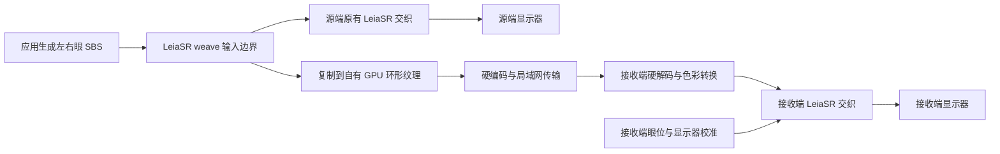

# ToDesk 与 LeiaSR 局域网立体画面共享调研

调研日期：2026-10-21。

目标：尽量统一接入已有 LeiaSR 程序，把交织前的 SBS 画面送到另一台电脑，由接收客户端使用对方的 LeiaSR 显示器和本地追踪重新交织。用户已确认可以独立实现传输，不要求复用 ToDesk。

结论：技术路线可行，建议实现 **LeiaSR 进程内采集适配层、独立发送器、独立接收播放器**。已有 SDK 提供明确的 SBS 输入边界，适合跨应用复用。需要按图形 API 和接口族逐步覆盖；目前不能承诺一个 hook 覆盖所有 LeiaSR 程序。

## 数据链路

网络上传输 SBS 视频及布局、色彩、帧序号等元数据。GPU 共享句柄只用于同一电脑内部的应用与发送器之间，不能跨电脑传递后直接使用。

采集必须发生在交织前。已交织画面包含发送端显示器的光学映射和眼位条件，不能作为另一台屏幕的通用输入；即使两台显示器型号相同，也应各自在最终显示端执行交织。SBS 可以先压缩再传输，“直接传 SBS”不意味着发送未经压缩的像素。

## 本机 ToDesk 的实际证据

### 文件身份

本机 ToDesk 安装目录为 `C:\Program Files\ToDesk`。文件版本和 SHA256 已读取；未启动或修改 ToDesk，也未发起远程连接。

| 文件 | 本机身份 |
| --- | --- |
| ToDesk.exe | 4.8.8.3，80,772,608 字节 |
| zrtc.dll | 3,4,0,0409；描述 `ZulerRTC(1539464f5,f9b8f0fbfe\|2026-04-09 11:47:15)`；61,063,168 字节 |
| codec_checker.exe | 301,568 字节 |

`ToDesk.exe` SHA256：`d9f12495e225b318f8bc947043bad642070a735804ee3873ad931e4220733da0`。

`zrtc.dll` SHA256：`2a9a9fc26c383b08acef618ced8a98b4f02662e73cf6ad6d7b6c26bc9d19eddf`。

完整导入、导出、候选字符串及文件偏移保存在 [local-binary-evidence.json](F:/开发项目/LAN3DShare/RE/local-binary-evidence.json)。采集脚本 [inspect_local_binaries.py](F:/开发项目/LAN3DShare/RE/inspect_local_binaries.py) 只读取二进制文件，不加载目标 DLL。字符串筛选结果包含待人工核验的候选项，不能将每个匹配都当作有效实现证据。

### 主程序与媒体 DLL 的边界

PE 导入表确认 `ToDesk.exe` 从 `zrtc.dll` 导入 101 个符号；这些符号全部能在当前 `zrtc.dll` 的 3,142 个命名导出中找到。这比单独搜索字符串更能确定两者之间存在正式的二进制调用边界，但不证明每个接口在当前会话都被调用。

以下名称来自导出表；C++ 签名由 Windows DbgHelp 解名。RVA 使用十进制，供之后定位对应版本二进制。

| 导入或导出接口 | zrtc.dll RVA 十进制 | 已确认的接口形态 |
| --- | ---: | --- |
| `zuler::createDesktopSource` 两个重载 | 119168 / 119264 | 返回 `SharedPtr<DesktopSourceItf>`；含 Source、CaptureMode 等参数 |
| `zuler::CreateErizoClient` | 52928 | 需要私有 CONFIG 和 ThreadItf；返回 ErizoClientItf |
| `zuler::CreateRenderingModule` | 7561696 | 接收 RenderingItf 指针；返回 RenderingModuleItf |
| `zuler::RenderingItf::RenderToSurface` | 5584 | 虚函数，参数含 `SharedPtr<VideoFrameItf>`，返回 RenderContext |
| `zuler::createD3DRender` | 7714672 | 接收 HWND、RenderMode 等参数 |
| `zuler::codec_sdk::CreateCodecSDKItf` | 4673520 | 返回 CodecSDKItf |
| `CreateVideoReaderItf` / `CreateVideoWriterItf` | 6584912 / 6600864 | 存在未修饰名称导出；未恢复调用签名或用途契约 |

因此，不能说 ToDesk 内部没有可接入的视频帧边界；本机组件确实暴露了视频源、帧、渲染等接口。但这些是私有 ABI，当前缺少头文件、对象布局、虚函数契约、线程与生命周期约束。也不能把某个基类虚函数导出直接当作实际解码输出回调，或仅凭 Reader/Writer 命名认定它们是通用共享纹理接口。

### 实现线索及其限度

当前 `zrtc.dll` 中有如下可定位的静态字符串：

| 线索 | 文件偏移十进制 | 能支持的结论 |
| --- | ---: | --- |
| `CreatePeerConnection` | 44511845 | 包含 PeerConnection 相关代码或诊断文本 |
| `WebRTC.DesktopCapture.Win.WgcCapturerFrameTime` | 46394784 | 包含 WGC 采集相关实现线索 |
| `ScreenCapturerWinDirectx::CaptureFrame` | 47101536 | 包含 DirectX 桌面采集实现线索 |
| `DxgiOutputDuplicator::DuplicateOutput()` | 48158122 | 包含 DXGI duplication 实现线索 |
| `NvEncodeAPICreateInstance` | 44910543 | 包含 NVIDIA 编码器加载路径线索 |
| `../../zuler/nvidia/dependencies/NvCodec/NvEncoder/NvEncoderD3D11.cpp` | 44918360 | 包含 D3D11 NVENC 相关源码路径 |
| `AMFInit` | 44968184 | 包含 AMD AMF 加载线索 |

这与 ToDesk 官方描述的采集、压缩、网络传输、解码链路一致。官方 RTC 说明还介绍了 RTP、拥塞控制和接收缓冲，但这些资料不足以恢复当前版本的完整会话协议。[视频编解码说明](https://www.todesk.com/news/410.html)、[RTC 说明](https://www.todesk.com/news/420.html)。

公开帮助列出 P2P、RUDP P2P 和中转模式；认证与服务器通信仍有公网域名要求。因此画面直连和断外网建立会话是两个不同能力。[连接模式](https://www.todesk.com/helpcenter/enterprise-75.html)、[防火墙说明](https://www.todesk.com/helpcenter/solo-63.html)。

本次未找到公开且可直接使用的 ToDesk 自定义纹理输入、解码纹理输出 SDK。其公开命令行文档主要覆盖连接和配置，不提供媒体帧接入契约。[命令行文档](https://www.todesk.com/helpcenter/solo-213.html)。这不是“绝对不存在商业定制接口”的判断。

本轮没有可用 IDA MCP 连接，没有执行反编译、调用链追踪、抓包或双端会话测试；因此不把上述静态线索描述为已恢复的完整协议，也不据此断言当前正在使用哪一种采集器、codec 或网络模式。

## 统一 LeiaSR 采集入口

本机安装项显示 LeiaSR Platform 1.36.4，另有 SDK 1.36.2 源码包。当前平台 DirectX DLL 的文件版本字符串为 `57c9f88a7d v1.0.3.0 2026-06-08T09:19:11Z`；平台版本、SDK 版本和该文件版本是不同标识。

安装目录中的 `SimulatedRealityDirectX.dll` 有 137 个命名导出，`SimulatedRealityOpenGL.dll` 有 33 个；本轮 PE 检查确认新工厂和旧类接口同时存在。

| 路径 | 捕获办法 | 关键限制 |
| --- | --- | --- |
| 新 DX11 | 截获 `CreateDX11Weaver` 返回对象；记录 `setInputViewTexture` 的 SRV；在 weave 前复制当前视图 | 需要保留 SRV 格式、mip 和 array slice；处理 context 类型 |
| 新 DX12 | 截获 `CreateDX12Weaver`；记录 input resource、command list；在 weave 前录入 copy | 输入直接是 `ID3D12Resource*`；仍需追踪实际提交 queue、状态和 fence |
| 旧 DX11 / DX12 类 | 跟踪构造、`setInputFrameBuffer`、`getFrameBuffer` 及 weave 重载 | 有的程序直接绘制 SDK 内部 SBS buffer，未必调用 setter |
| DX9 / DX10 / OpenGL | 独立 API 适配器；GL 在有效 context/thread 中复制 | 不能直接套用 DX11 资源共享实现 |
| 自行编写交织 shader | 按应用或 GPU 绑定路径补适配 | 底层校准参数 API 没有统一 SBS 资源入口 |
| 原生 Vulkan | 待定位其实际交织或 DX/GL interop 出口 | 本地两套 SDK 的 weaver 头文件未发现原生 Vulkan weaver 接口 |

源码入口：[DX11 接口](F:/GithubMods/LeiaSR-SDK-1.36.2-win64/include/sr/weaver/dx11weaver.h:29)、[DX12 接口](F:/GithubMods/LeiaSR-SDK-1.36.2-win64/include/sr/weaver/dx12weaver.h:29)、[统一 weave 语义](F:/GithubMods/LeiaSR-SDK-1.36.2-win64/include/sr/weaver/IWeaverBase.h:29)、[GL 接口](F:/GithubMods/LeiaSR-SDK-1.36.2-win64/include/sr/weaver/glweaver.h:45)、[底层参数接口](F:/GithubMods/LeiaSR-SDK-1.36.2-win64/include/sr/weaver/WeaverC.h:71)。

新接口采用 C++ 虚继承和基于 `std::type_index` 的查询，并非 COM IUnknown；必须保持查询、对象身份和 `destroy()` 的语义。采集器应按核实过的接口族编译适配，不能猜测固定 vtable 下标。[commoninterfaces.h](F:/GithubMods/LeiaSR-SDK-1.36.2-win64/include/sr/utility/commoninterfaces.h:14)。

建议使用统一启动或进程接入组件，在选定应用内识别实际加载的 SDK 模块并挂接。只在某个目录放 proxy DLL 不能覆盖绝对路径加载、已有模块、应用私带 runtime 等情况；系统平台 DLL 本身不需要被替换。

现有 YakuzaVRMod 与 FallenFlower3D 的构建缓存均指向 UU3D 下的 SR-lib SDK 1.34.10，不能把它们当作两个不同 SDK 版本的样本。对照 1.36.2 时，所检查的七个公开 weaver/commoninterfaces 头文件类和方法声明相同，但这仍不等于所有运行时私有布局与 ABI 均已验证。[Yakuza 构建记录](F:/GithubMods/Yakuza/YakuzaVRMod/build/CMakeCache.txt:264)、[FallenFlower 构建记录](F:/GithubMods/FallenFlower3D/build/CMakeCache.txt:228)。

## 必须解决的采集与同步问题

### 一帧不一定只 weave 一次

FallenFlower3D 是明确的反例：[GpuBackend.cpp](F:/GithubMods/FallenFlower3D/native/GpuBackend.cpp:378) 先 `composeSbs(true)` 并 weave 遮挡 mask，再覆盖同一 SBS 纹理，执行 `composeSbs(false)` 并 weave 最终画面。

所以 setter 只负责记录绑定，不能当作每帧通知；每次 weave 是候选采集点，也不能全部直接发送。采集器需要按窗口、weaver、目标资源和呈现关系区分通道，允许用户选流。通用识别暂不成立的程序应使用明确的适配规则。只保留原纹理指针、随后异步读取，会遇到同帧内被覆盖或下一帧复用的问题。

采集时把该次 SBS 按命令顺序复制到自有槽中，槽只有在 GPU copy 完成且编码器使用结束后才可复用。环形队列满时跳过新采集，避免阻塞源端本地显示。SDK 内部或应用自己创建的纹理不能假定可跨进程共享。

### DX12 weave 返回时 GPU 可能还没执行

官方 DX12 sample 的 weave 在 [main.cpp:2014](F:/GithubMods/LeiaSR-SDK-1.36.2-win64/examples/directx12_weaving/directx12_weaving/main.cpp:2014)，`Close/ExecuteCommandLists` 在 2031–2034。必须区分命令录制、提交和 GPU 完成。

复制应录在正确的宿主 command list 位置，遵循并恢复真实资源状态；跟踪该录制代次最终在哪个 queue 执行，再建立 GPU completion fence。还需处理 Reset、未提交、重执行、多列表提交和设备重建。不能仅依据 weave 返回、CPU 信号或固定时间延迟宣告纹理可编码。DX11 deferred context 也需要对应的提交处理。

自有共享纹理和共享 fence 可以连接同机采集、编码进程；第一版宜约束为同 adapter。跨 GPU 共享、布局和带宽是另一条验证路径。[Microsoft 共享资源接口](https://learn.microsoft.com/en-us/windows/win32/api/d3d12/nf-d3d12-id3d12device-createsharedhandle)、[命令提交与同步规则](https://learn.microsoft.com/en-us/windows/win32/direct3d12/executing-and-synchronizing-command-lists)。

## 传输和接收客户端

建议第一版采用 C++ 原生客户端：发送端按 GPU 能力选择低延迟硬编码；接收端硬解码，GPU 转换成 RGB SBS，再交给 SDK 的 DX11 weaver。图形 API 可以不同：DX12 源程序输出的视频可以由 DX11 接收端显示。

编码器选型应现场查询双方 codec、profile、最大尺寸与吞吐能力。NVIDIA NVENC 已提供 D3D 资源输入及 DX12 fence 对接，但不能据此假定远端显卡支持相同 codec 或 4:4:4 硬解码。[NVENC 编程指南](https://docs.nvidia.com/video-technologies/video-codec-sdk/13.1/nvenc-video-encoder-api-prog-guide/index.html)。

实现顺序建议先用双方支持的 H.264 或 HEVC 建立闭环，再评估 AV1、4:4:4 和 HDR。避免 B 帧重排和长缓冲；码率、画质及延迟通过实测选择，不在本轮给出未经测量的保证。

局域网会话可以按 IP 直连，以成熟 RTP/UDP 实现承载视频并配合控制通道，提供配置协商、统计反馈和关键帧请求；也可使用具有这些功能的 RTC 库。第一版无需 NAT 穿透或公网中继，但仍须处理分片、乱序、丢包、积压及断线重连，不能把大编码帧直接作为单个 UDP 包发送。

SBS 两眼作为一个完整视频帧编码和展示，避免左右眼的帧序号不一致。可以丢未编码的过时帧、或已经解码但尚未显示的过时帧；不能随意丢弃有后续依赖的压缩参考帧。

### 帧描述与色彩

至少传递：配置代次、帧序号、时间戳、实际纹理总尺寸、左右眼矩形与顺序、有效图像区域、像素宽高比，以及色域、传递函数、YUV 矩阵和 full/limited range。尺寸或 codec 改变时重新协商并建立新的解码状态。

不能直接把 SDK 的 width 参数当总 SBS 宽。官方 sample 在 [1150 行](F:/GithubMods/LeiaSR-SDK-1.36.2-win64/examples/directx12_weaving/directx12_weaving/main.cpp:1150) 创建 `g_viewTextureWidth * 2` 宽度资源，却在 [1404 行](F:/GithubMods/LeiaSR-SDK-1.36.2-win64/examples/directx12_weaving/directx12_weaving/main.cpp:1404) 向输入接口传 `g_viewTextureWidth`。应读取实际资源描述，并独立定义网络布局。

NV12/P010 解码结果需要按协商色彩条件转换成 weaver 可接受的 RGB 纹理；缩放和色度采样应尊重每眼边界。任意 HDR 输入需要正确保留或明确转换，不能直接当普通 SDR。

未压缩 BGRA8 数据量说明了硬编码的必要性，以下只计算像素负载，不含传输开销：

| SBS 总尺寸 | 帧率 | 原始带宽 |
| --- | ---: | ---: |
| 3840 × 1080 | 60 | 7.96 Gbit/s |
| 3840 × 2160 | 60 | 15.93 Gbit/s |
| 7680 × 2160 | 60 | 31.85 Gbit/s |

这些是 `宽 × 高 × 4 字节 × 8 × 帧率` 的计算值，不是网络测速或编码码率建议。

### 接收端本地交织

[官方 DX11 示例](F:/GithubMods/LeiaSR-SDK-1.36.2-win64/examples/directx11_weaving/directx11_weaving/main.cpp:796) 可以作为接收器骨架：使用本机 SRContext、目标屏幕与 HWND，把图片输入替换为解码并转换后的 SBS SRV。窗口移动、分辨率和 DPI 变化都要同步更新；最终交织 backbuffer 应匹配客户端的物理像素尺寸，交织后不再任意缩放。

网络到帧和本地显示应采用独立循环：没有新视频帧时保留上一张完整 SBS，每个显示周期仍可根据本地最新眼位重新 weave。此方案由 SDK 契约支持，实际追踪效果仍需双端屏幕验收。`setLatency` 对应本次 weave 到本地显示的预测时延，不应直接填整个网络视频延迟。[窗口与预测契约](F:/GithubMods/LeiaSR-SDK-1.36.2-win64/include/sr/weaver/IWeaverBase.h:29)。

## 两个人能够看到什么

两端独立交织，可以让两位观察者各自收到同一组左右眼图像。但远端重新交织不能重建另一观察位置的完整相机视图。

Yakuza 的 [StereoRuntime.cpp](F:/GithubMods/Yakuza/YakuzaVRMod/src/stereo/StereoRuntime.cpp:116) 会把源端头部/眼位写入相机投影；FallenFlower 的 [Plugin.cs](F:/GithubMods/FallenFlower3D/managed/Plugin.cs:363) 也会把 headOffset 写入 view。直接共享其 SBS 时，远端会看到发送者头动造成的视角变化。

第一版应定义为“共享立体视角，各自本地交织”。使用固定或中立源视角时更适合共同观看。双方各自探头获得独立透视，需要源端分别渲染，或增加深度、相机参数等数据做受限重投影；仅两张图无法补出被遮挡的内容。

两端刷新也不天然同一时刻：接收端至少增加采集、编解码及传输时延。第一版保留源端原有低延迟显示，远端展示最新完整帧。如果要求两块屏在同一时刻显示同一帧，则需要时钟对齐、统一播放时间以及源端缓冲等待。

## 建议的首个实现范围和验收顺序

1. **接收器与合成源闭环。** 用带左右眼标记、色彩块、帧序号的 SBS 测试源验证 LAN 编解码，以及接收机的显示器选择、本地追踪和重复帧交织。先用可控输入定位传输问题。
2. **DX11 统一采集。** 覆盖新工厂接口和旧输入路径，验证捕获像素、SRV 视图、窗口选择和资源生命周期，以官方 sample 为可控宿主。
3. **DX12 统一采集。** 完成命令列表提交关联、资源状态、共享槽与 fence；用 sample 和现有两个 Mod 的真实调用模式检验，特别是同纹理多次 weave 的情况。
4. **补兼容矩阵。** 按实际应用增加 DX9/10、GL、32 位或私带 runtime；自定义 shader 和 Vulkan 单列覆盖范围，不按品牌名称推断支持。

首个版本宜限定一个被选中的应用/画面流、一台接收机、SDR、同 adapter 编码，保持协议可扩展。上述阶段都是后续实施建议，本轮没有生成可运行收发客户端。

验收应分别记录捕获正确性、GPU 同步、双眼帧序、编解码色彩、网络延迟和丢包恢复、双端 LeiaSR 实际追踪。软件构建通过或离线像素匹配都不能替代两台显示器的实机结果。

## 本轮交付与剩余证据

完成：本机 ToDesk 与 LeiaSR 二进制身份和接口清单、ToDesk 官方资料核查、LeiaSR SDK 和现有应用源码核查、统一采集设计及实现顺序。

未完成且不作已验证声明：ToDesk 内部函数反编译及私有协议恢复、真实运行路径追踪、接收机环境核实、收发客户端实现、局域网和两台 LeiaSR 显示器测试。没有修改 ToDesk、LeiaSR 安装文件或现有游戏工程。
