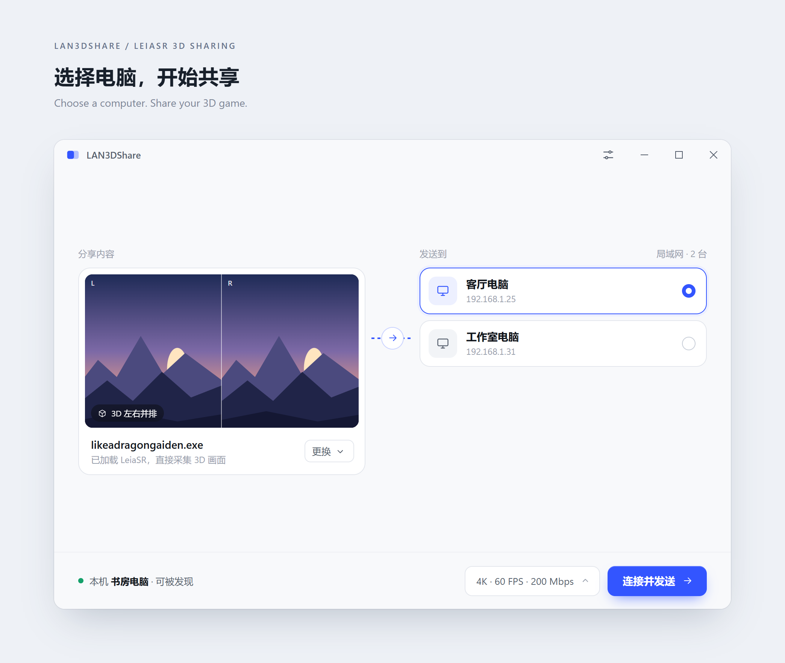
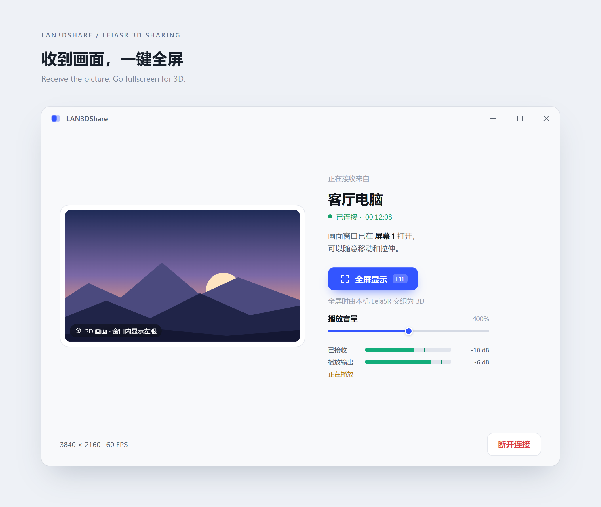
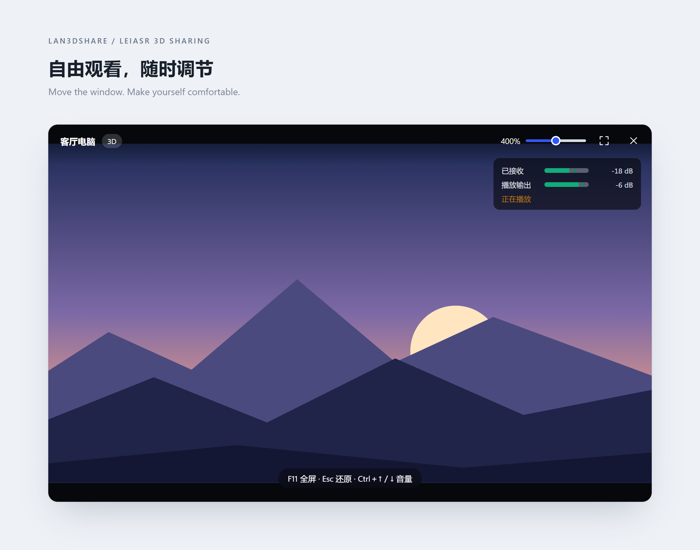

# LAN3DShare

**在局域网内，把 LeiaSR 的 3D 游戏画面和声音共享给另一台电脑。**

一台电脑运行游戏，另一台连接 LeiaSR 显示器，就能一起看 3D。两边使用同一个程序，自动发现彼此；接收画面可以自由移动、调整大小或全屏，音量也能随时调节。**普通桌面的 2D 共享是附加功能。**

*Share LeiaSR 3D games and audio with another computer on your local network. Regular 2D desktop sharing is also supported.*

[下载最新版 / Download](https://github.com/PureDark/LAN3DShare/releases/latest) · [English](#english)

## 三步开始

1. **两边打开程序。**下载同一版本的 `win64.zip`，解压并打开 `LAN3DShare.exe`，让两台电脑连到同一个局域网。
2. **发送方选择游戏和对方电脑。**先在游戏中开启 LeiaSR，再点击 **连接并发送**。
3. **接收方全屏观看 3D。**画面会自动打开；按 **F11** 或双击画面进入全屏。按 **F12** 切换 3D / 2D：2D 时发送端只传左眼，在所选画质上限内保留原始分辨率，码率设置不变；再按一次恢复双眼。窗口模式显示 2D 预览。

需要 Windows 电脑和支持编解码的 NVIDIA 显卡。想在两边都看 3D，两边都需要 LeiaSR 显示器及运行环境。也支持兼容的 LeiaSRBridge；仅分享普通画面时不需要 LeiaSR。

## 界面预览

**接收后，一键全屏观看 3D，也能单独调节音量。**

**窗口可以移动、拉伸；鼠标离开后，顶部控件会自动隐藏。**

界面图使用示例画面与数据，展示操作方式。UI previews use sample content and data.

## 更新

在 **设置 → 程序更新** 中检查、下载，然后点击 **安装并重启**。没有更新入口的旧版需先手动升级一次。无需登录或授权，访问失败会直接提示。[更新说明](docs/UPDATING.md)

## English

**LAN3DShare is built for sharing LeiaSR 3D over a local network.** Run a game on one PC and watch it with sound on another LeiaSR-equipped PC. The same app handles sending and receiving, finds nearby computers, and offers a movable viewing window, fullscreen 3D and live volume controls. Regular 2D screen sharing is an extra feature.

1. Download `win64.zip`, extract it and open `LAN3DShare.exe` on both PCs on the same LAN.
2. Enable LeiaSR in the game. On the sender, select the game and the other PC, then click **连接并发送 / Connect and send**.
3. The receiver opens the picture automatically. Press **F11** or double-click for 3D fullscreen. **F12** switches to 2D: the sender transmits only the left eye, preserving its resolution within the selected quality limit and dedicating the current bitrate to it. Press again to restore both eyes. Windowed mode shows a 2D preview.

Requires Windows and NVIDIA GPUs supporting video encoding/decoding. To watch in 3D on both PCs, each needs a LeiaSR display and runtime. Compatible LeiaSRBridge setups are supported. LeiaSR is optional for ordinary 2D sharing.

**Updates:** use **Settings → Program update → Check → Download → Install and restart**. Clients without an update button need one manual upgrade. No sign-in or token is needed; failed requests show an error. [Update guide](docs/UPDATING.md).

---

[技术说明 / Technical notes](docs/TECHNICAL_NOTES.zh-CN.md) · [验证记录 / Validation](VALIDATION.md) · [构建 / Building](docs/BUILDING.md)
