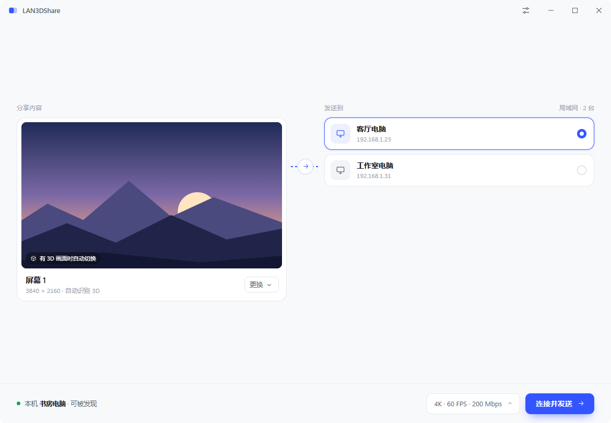
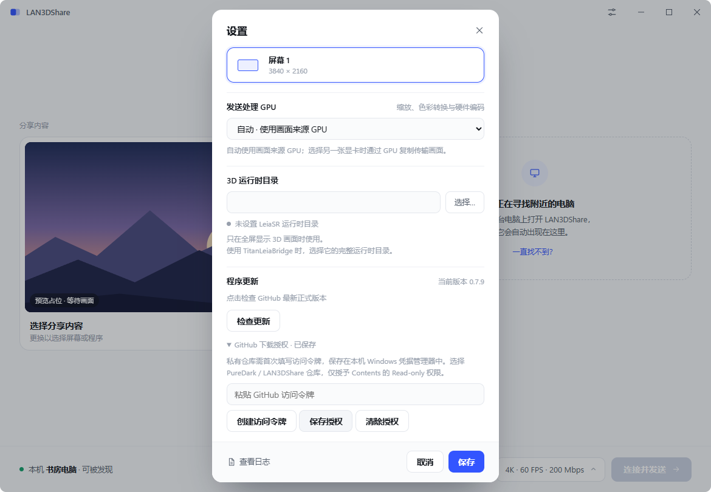
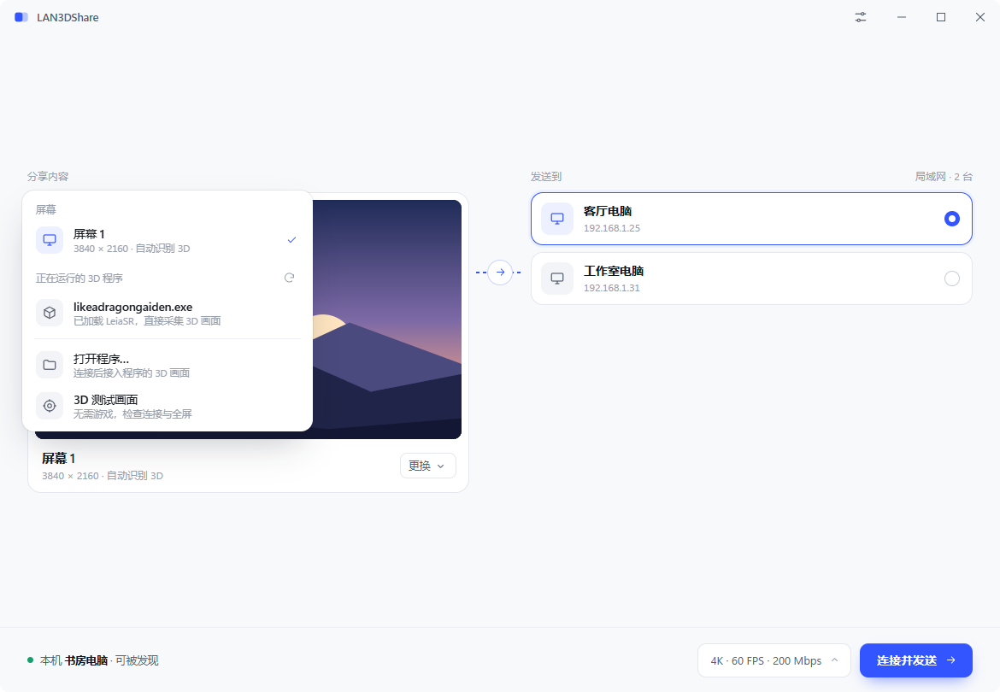
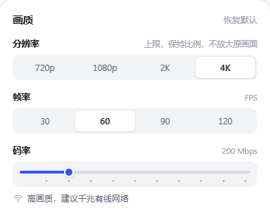
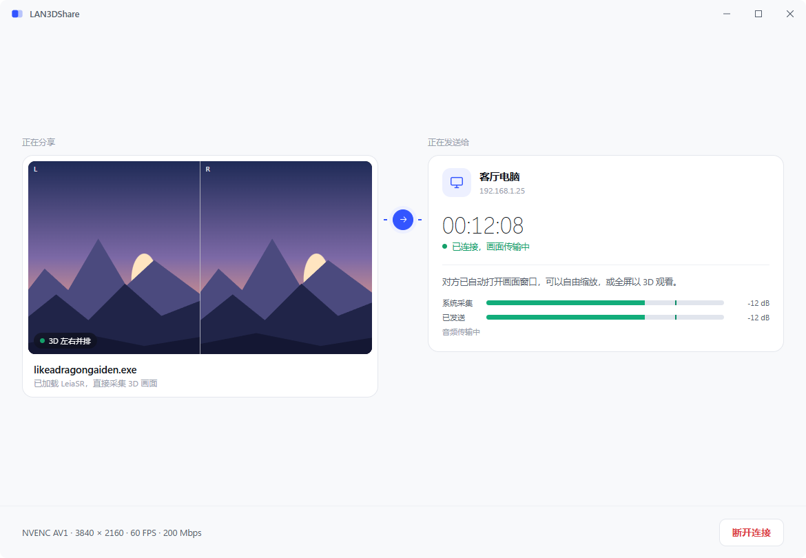
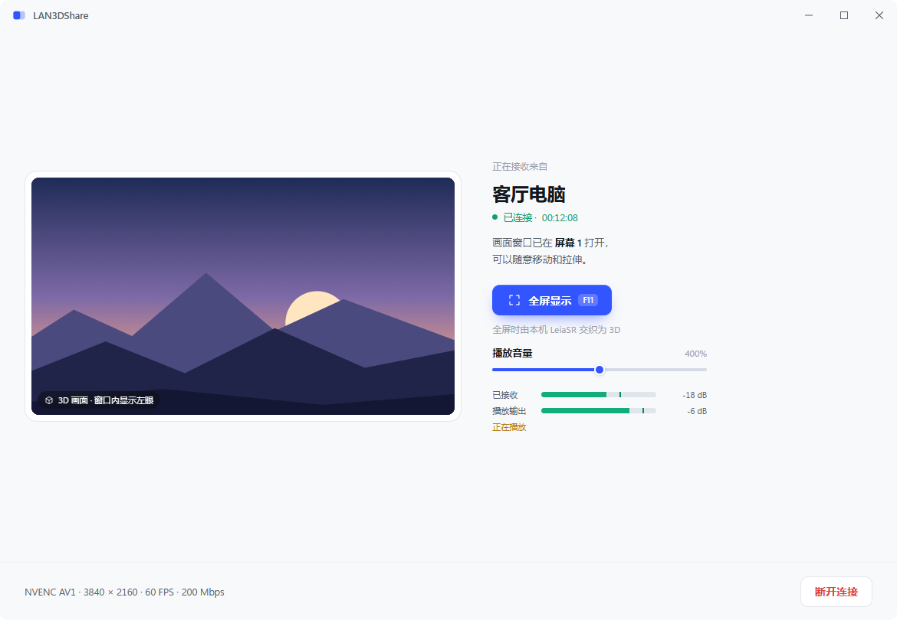
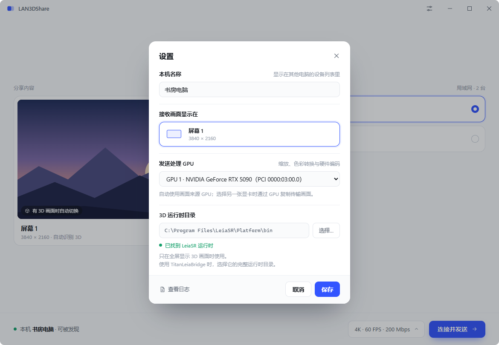
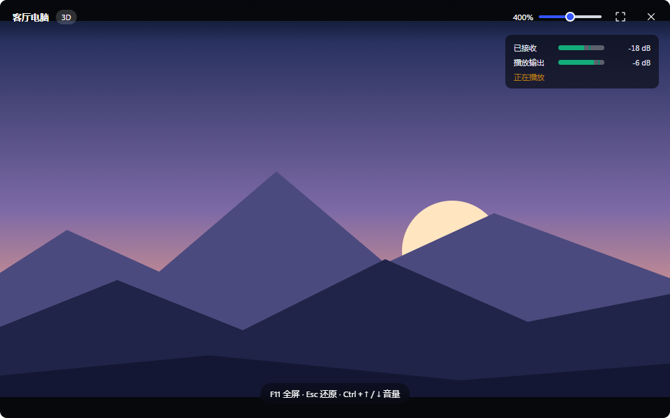

# LAN3DShare

**Windows 局域网 2D / 3D 画面与声音共享 · LAN screen and audio sharing for Windows**

[中文](#中文) · [English](#english) · [界面预览 / UI gallery](#ui-gallery) · [下载 / Download v0.7.9](https://github.com/PureDark/LAN3DShare/releases/tag/v0.7.9)



<a id="中文"></a>
## 中文

LAN3DShare 将普通桌面或游戏交织前的 **SBS 双眼画面**发送到局域网中的另一台电脑，并同步传输系统声音。发送与接收使用同一个图形客户端，无需命令行。接收端可在小窗口中预览，也可在 LeiaSR 显示器上全屏显示 3D。

### 功能

- **发送、接收一体**：自动发现局域网客户端，选中对方并点击“连接并发送”。一次连接一台设备。
- **普通屏幕与 3D 来源**：共享整块屏幕、选择运行中的 3D 程序、打开指定程序，或使用内置 3D 测试画面。
- **DX11 / DX12 SBS 采集**：通过 `SimulatedRealityDirectX.dll` 接入交织前的左右眼画面，支持已运行程序的热附加及兼容的 TitanLeiaBridge 转发路径，尽量避免逐个修改 Mod。具体 API、ABI 与资源约束见技术记录。
- **GPU 图像管线**：DirectX 采集、复制、缩放与颜色转换，NVENC 编码、NVDEC 解码；支持 AV1、HEVC / H.265、H.264，按硬件能力选择。
- **可选择发送 GPU**：用 PCI 总线地址区分同型号显卡；跨 GPU 使用两端 D3D12 Copy 队列和共享资源传递图像。
- **自由接收窗口**：可移动、拉伸，支持全屏；顶部工具栏和音量表在鼠标离开控件区域 3 秒后隐藏，移回时显示；只有收到 LeiaSR SBS 且进入全屏时，才调用接收机本地 runtime 交织。
- **画质与带宽控制**：720p / 1080p / 2K / 4K，30 / 60 / 90 / 120 FPS 目标；码率滑条 0–1000 Mbps，整百吸附。0 为自动，非零低于 20 时按 20 Mbps 使用。
- **系统声音与同步**：跟随实际呈现的视频推进音频，处理跳帧、暂停和重连；两端实时音量表，接收端 0–800% 播放音量可随时调整。
- **接收端爆音保护**：保守修复孤立采样尖峰，平滑限幅与音量变化，断流恢复淡入；固定增加约 2.1 ms 音频处理延迟。

- **应用内更新**：从 GitHub 正式 Release 检查、下载、校验并安装，完成后自动重启；支持私有仓库授权。

### 下载与开始使用

1. 在两台电脑上下载 [LAN3DShare-0.7.9-win64.zip](https://github.com/PureDark/LAN3DShare/releases/download/v0.7.9/LAN3DShare-0.7.9-win64.zip)，解压后双击 `LAN3DShare.exe`。这是**免安装 ZIP 包**；请保留同目录的 `LAN3DCapture.dll`。私有仓库的下载需要登录有访问权限的 GitHub 账号。
2. 两台电脑接入可互通的 IPv4 局域网。若 Windows 弹出防火墙提示，允许程序在所用的专用网络通信。
3. 在发送方选择“分享内容”和接收电脑，点击 **连接并发送**。对方会自动打开接收窗口。
4. 如需 3D，先在源程序中启用 LeiaSR。接收方进入 **全屏显示**（F11 或双击画面），由接收机的 LeiaSR runtime 交织。Esc 退出全屏。
5. 声音偏小时，在**接收方**调节“播放音量”，无需重连，也无需改变发送方 Windows 音量。任一端断开即可结束共享，不会关闭源游戏。

**首次升级到 0.7.9：**旧版没有更新入口，需结束共享、退出客户端，手动下载并覆盖一次。从此可在 **设置 → 程序更新** 中依次点击 **检查更新 → 下载更新 → 安装并重启**。共享期间不会执行更新；已有设置保留。安装包先做 SHA256 和逐文件校验，再等待客户端退出后替换，失败时尝试恢复原文件。未变化的采集 DLL 会跳过替换；如果未来更新改变了游戏正在使用的采集 DLL，请关闭对应游戏后重试。

**私有仓库首次授权：**在“GitHub 下载授权”里点击“创建访问令牌”，使用有仓库访问权的账号，仅选择 `PureDark/LAN3DShare`，授权 **Contents → Read-only**。将生成的 fine-grained token 粘贴到客户端，点击“保存授权”。令牌保存在当前 Windows 用户的凭据管理器，不写进配置、日志或发布包。每台电脑配置一次；令牌到期或被撤销时重新授权。程序目录需要当前用户可写。



### 环境与 3D 显示规则

需要 Windows x64、Microsoft Visual C++ x64 运行库、Microsoft Edge WebView2 Runtime，以及具备所用编解码能力的 NVIDIA 显卡与驱动。生产硬件路径不会自动退回 CPU 图像处理。仅共享普通画面时，不需要 LeiaSR。

3D 接收需要受支持的 LeiaSR 显示器及已安装的 runtime。设置中默认目录为 `C:\Program Files\LeiaSR\Platform\bin`；使用 TitanLeiaBridge 时选择其完整 runtime DLL 目录。发布包不附带厂商 runtime。

| 收到的画面 | 窗口模式 | 全屏模式 |
| --- | --- | --- |
| 普通桌面 | 2D 显示 | 2D 显示 |
| LeiaSR SBS | 左眼 2D 预览 | 接收机本地 LeiaSR 交织 |
| LeiaSR runtime 不可用 | 2D 预览并提示 | 回退为 2D 窗口，保留连接 |

双方共享同一对游戏视图，各自在本机交织；接收方的头部移动不会产生独立游戏视角。

### 画质、性能与当前范围

- **4K 表示整个 SBS 为 3840×2160，而非每眼 4K。**默认目标为 4K / 60 FPS / 200 Mbps，实际帧率取决于源程序、显卡、网络与接收显示链路。
- 主视频走 GPU，不整帧回读到 CPU；仍有必要的 GPU 复制和颜色转换。界面缩略图、音频、控制和压缩码流处理仍使用 CPU。
- 视频采用 SDR、8-bit、4:2:0 有损压缩，暂不支持 HDR / 10-bit；自动码率基于实际发送反馈，不等同于独立带宽测速。
- 当前一次只支持一发一收；不提供键鼠远程控制、设备身份认证或传输加密，面向可信局域网。
- 只支持兼容的 Windows x64 来源。桌面鼠标指针尚未合成，不支持旋转屏；并非所有 Mod、未来 runtime ABI 或 DX12 资源形式都已验证。
- 热附加、GPU 传输、实际游戏和双机显示的验证范围分别记录在 [VALIDATION.md](VALIDATION.md)，不以单项编码吞吐代替端到端验收。

设备未出现时，检查防火墙、网段与无线客户端隔离；等待 3D 时，确认选对来源且源程序持续输出 LeiaSR。日志可从 **设置 → 查看日志** 打开。历史实现细节见 [技术记录（中文）](docs/TECHNICAL_NOTES.zh-CN.md)。

<a id="english"></a>
## English

LAN3DShare sends a regular desktop or a game's **pre-weave side-by-side stereo image** to another computer on the local network, together with synchronized system audio. One graphical application handles both sending and receiving. Preview the stream in a movable window, or display it in 3D on a LeiaSR monitor in fullscreen.

### Features

- **One app for both roles.** Automatically discover LAN peers. Select a computer and connect to become the sender; one receiver per session.
- **Desktop and stereo sources.** Share a screen, select a running 3D application, launch a chosen executable, or use the built-in stereo test pattern.
- **DX11 / DX12 pre-weave capture.** Hook `SimulatedRealityDirectX.dll` to obtain left/right SBS frames, including hot attachment to running applications and compatible TitanLeiaBridge forwarding implementations. This avoids per-Mod changes where the supported interfaces and resource layouts are available.
- **GPU video processing.** DirectX capture, copies, scaling and color conversion; NVIDIA NVENC encoding and NVDEC decoding. AV1, HEVC / H.265 and H.264 are selected according to hardware support.
- **Selectable sending GPU.** PCI bus addresses distinguish identical GPUs. Cross-adapter transport uses D3D12 Copy queues on both GPUs and shared resources.
- **Flexible viewing.** Move or resize the receiver window. The top toolbar and audio meters hide three seconds after the pointer leaves their area and reappear on hover; enter fullscreen for local LeiaSR weaving only when the stream is identified as LeiaSR SBS.
- **Quality controls.** 720p / 1080p / 2K / 4K and target rates of 30 / 60 / 90 / 120 FPS. The 0–1000 Mbps slider snaps near multiples of 100; 0 means automatic, and nonzero values below 20 use 20 Mbps.
- **Synchronized system audio.** Audio follows presented video through frame drops, pauses and reconnections. Both ends show audio levels; receiver-local playback volume adjusts live from 0–800%.
- **Receiver audio protection.** Conservative isolated-spike repair, smooth limiting and volume transitions, and a fade-in after interruptions. Fixed processing delay is approximately 2.1 ms.

- **In-app updates.** Check, download, verify and install official GitHub Releases, then restart automatically; private-repository authorization is supported.

### Download and quick start

1. Download [LAN3DShare-0.7.9-win64.zip](https://github.com/PureDark/LAN3DShare/releases/download/v0.7.9/LAN3DShare-0.7.9-win64.zip) on both computers, extract it, and open `LAN3DShare.exe`. This is a **portable ZIP**, not an installer. Keep `LAN3DCapture.dll` next to the executable. Private-repository downloads require a GitHub account with repository access.
2. Connect both computers to a reachable IPv4 LAN. Allow the app through Windows Firewall on the private network in use if prompted.
3. On the sender, choose the source and destination computer, then click **连接并发送 / Connect and send**. The receiver window opens automatically.
4. For stereo, enable LeiaSR in the source application. On the receiver, use **全屏显示 / Fullscreen**, F11, or double-click the image. Esc returns to windowed mode.
5. Adjust **播放音量 / Playback volume** on the receiver while connected. No reconnect or sender Windows-volume change is needed. Disconnecting does not close the source game.

**First upgrade to 0.7.9:** older clients do not have an updater, so end sharing, exit the app and manually replace the files once. Future updates use **Settings → Program update → Check → Download → Install and restart**. Updates are blocked while sharing. Settings are preserved. The archive and individual files are verified before replacement; the helper waits for the client to exit and attempts rollback on failure. Unchanged capture DLLs are skipped. If a future release changes a DLL currently loaded by a game, close that game and retry.

**One-time private-repository authorization:** open **GitHub download authorization → Create access token**, sign in with an account that can access this repository, select only `PureDark/LAN3DShare`, and grant **Contents → Read-only**. Paste the fine-grained token and select **Save authorization**. It is stored in the current user's Windows Credential Manager, never in settings, logs or release packages. Configure each computer once; replace expired or revoked tokens. The application directory must be writable by the current user.

### Requirements and display behavior

Windows x64, the Microsoft Visual C++ x64 runtime, Microsoft Edge WebView2 Runtime, and NVIDIA GPUs/drivers supporting the selected encoding and decoding formats. The production hardware path does not silently fall back to CPU image processing. Regular 2D sharing does not require LeiaSR.

Stereo reception requires a supported LeiaSR display and an installed runtime. The default runtime directory is `C:\Program Files\LeiaSR\Platform\bin`; for TitanLeiaBridge, select its complete runtime DLL directory. Vendor runtimes are not included.

| Incoming content | Windowed | Fullscreen |
| --- | --- | --- |
| Regular desktop | 2D | 2D |
| LeiaSR SBS | Left-eye 2D preview | Locally woven by the receiver's LeiaSR runtime |
| Unavailable LeiaSR runtime | 2D preview with a notice | Falls back to a 2D window without ending the connection |

Both computers share the same pair of game views and weave locally. Receiver head movement does not create an independent game viewpoint.

### Quality, performance and scope

- **4K means a total packed SBS size of 3840×2160, not 4K per eye.** Defaults target 4K / 60 FPS / 200 Mbps; end-to-end performance depends on the source, GPUs, network and receiver display.
- Main video frames remain on the GPU, with necessary copies and color conversion. UI thumbnails, audio, control and compressed-stream handling still use the CPU.
- Video is lossy SDR, 8-bit, 4:2:0. HDR / 10-bit is not supported. Automatic bitrate reacts to actual transmission feedback; it is not a separate link-speed test.
- One sender and one receiver per session. Remote keyboard/mouse input, device authentication and transport encryption are not implemented; this is intended for trusted LANs.
- Compatible Windows x64 sources only. Desktop cursor composition and rotated displays are not supported. Not every Mod, future runtime ABI or DX12 resource configuration has been validated.
- [VALIDATION.md](VALIDATION.md) separates capture tests, GPU throughput, real-game checks and dual-computer display evidence; an encoder benchmark is not an end-to-end guarantee.

If peers are missing, check firewall rules, subnets and Wi-Fi client isolation. If the app is waiting for stereo, verify the selected source is actively rendering LeiaSR frames. Open logs via **设置 → 查看日志 / Settings → View logs**. Detailed implementation history is retained in [Chinese technical notes](docs/TECHNICAL_NOTES.zh-CN.md).

<a id="ui-gallery"></a>
## 界面预览 / UI gallery

以下截图由当前内嵌 HTML 界面使用示例数据生成，延续原设计稿。它们展示控件与状态，**不是实际游戏或实时连接截图，也不代表图中帧率实测结果**。当前程序界面为中文；本文提供中英文说明。

These previews render the current embedded HTML UI with sample data, based on the original design. They show controls and states, **not a live game/session or measured performance**. The current application UI is Chinese; this README is bilingual.

| 状态 / State | 预览 / Preview |
| --- | --- |
| 选择分享来源 / Choose a source |  |
| 画质控件局部 / Quality controls (detail) |  |
| 发送状态与音量表 / Sending and audio levels |  |
| 接收、全屏与实时音量 / Receiving, fullscreen and live volume |  |
| GPU、显示器与 runtime / GPU, display and runtime |  |
| 独立接收窗口 / Separate viewer window |  |

## 构建与项目结构 / Building and project layout

构建需要 Windows x64、Visual Studio 2026 C++ 工具链、Windows SDK、支持 Visual Studio 18 2026 生成器的 CMake 和 LeiaSR SDK 1.36.2。SDK 需单独安装，并传入你自己的路径。用户运行发布包无需编译或使用命令行。

Build with Windows x64, the Visual Studio 2026 C++ toolchain, Windows SDK, CMake with the Visual Studio 18 2026 generator, and LeiaSR SDK 1.36.2. Install the SDK separately and supply its path. End users do not need a compiler or command line.

```powershell
.\build.ps1 -SdkRoot 'C:\SDKs\LeiaSR-SDK-1.36.2-win64'
```

开发入口位于 `build/package`；`LAN3DSender` / `LAN3DReceiver` 为诊断工具，正式用户包使用一体化 `LAN3DShare.exe`。发布打包脚本会校验二进制与符号配对，并要求收齐 `package.ps1` 中列出的验证材料。

Build outputs are in `build/package`. `LAN3DSender` / `LAN3DReceiver` are diagnostic tools; the user package contains the unified `LAN3DShare.exe`. Release packaging verifies binary/PDB pairs and requires the evidence files listed in `package.ps1`.

| Path | 内容 / Contents |
| --- | --- |
| `src/ui`, `design` | 图形界面与设计稿 / UI and original design |
| `src/capture`, `src/app` | 桌面、SBS 采集与来源接入 / Desktop/SBS capture and source attachment |
| `src/media`, `src/net`, `src/session` | GPU 编解码、传输与发现 / GPU codecs, transport and discovery |
| `src/receiver`, `src/audio` | 显示、LeiaSR 与音频同步 / Presentation, LeiaSR and audio synchronization |
| `tests`, `tools` | 测试与诊断 / Tests and diagnostics |
| `docs/screenshots` | README 示例截图 / Documentation previews |

截图生成器为 [`tools/GenerateReadmeScreenshots.cjs`](https://github.com/PureDark/LAN3DShare/blob/master/tools/GenerateReadmeScreenshots.cjs)，使用 Playwright 与 Microsoft Edge。第三方依赖及各自许可证保留在 [`third_party`](https://github.com/PureDark/LAN3DShare/tree/master/third_party)。

Documentation previews are generated by [`tools/GenerateReadmeScreenshots.cjs`](https://github.com/PureDark/LAN3DShare/blob/master/tools/GenerateReadmeScreenshots.cjs) using Playwright and Microsoft Edge. Third-party components and their respective licenses are retained in [`third_party`](https://github.com/PureDark/LAN3DShare/tree/master/third_party).
